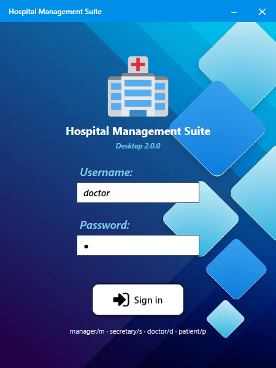
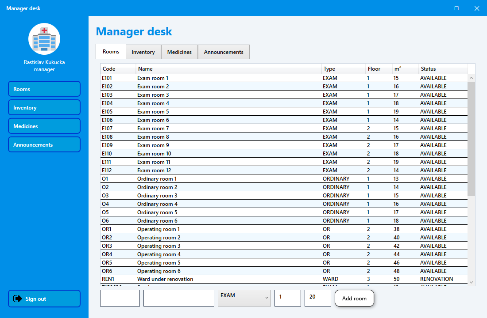
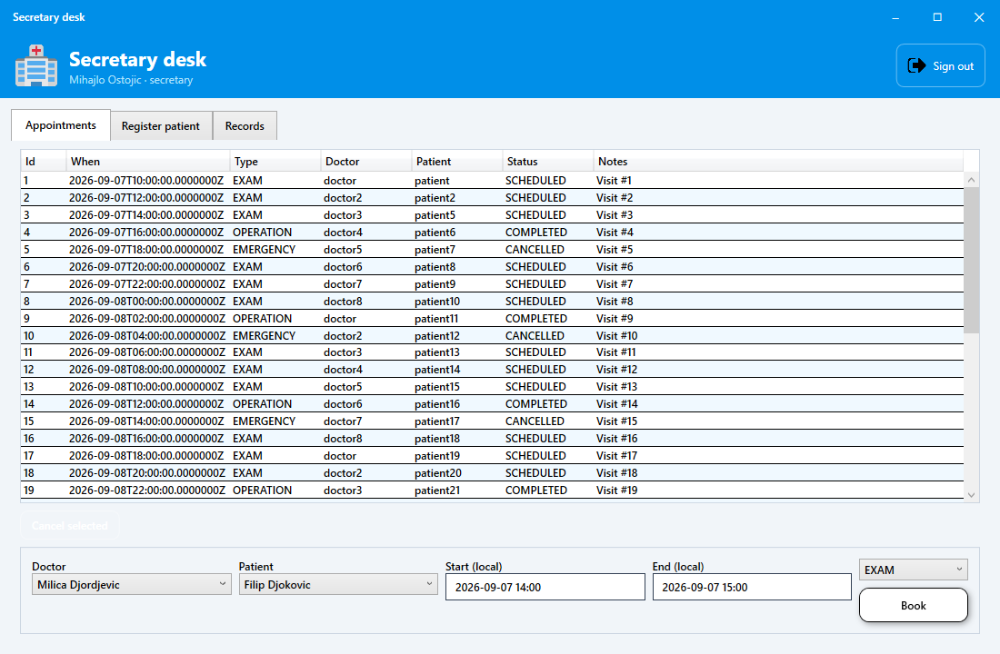
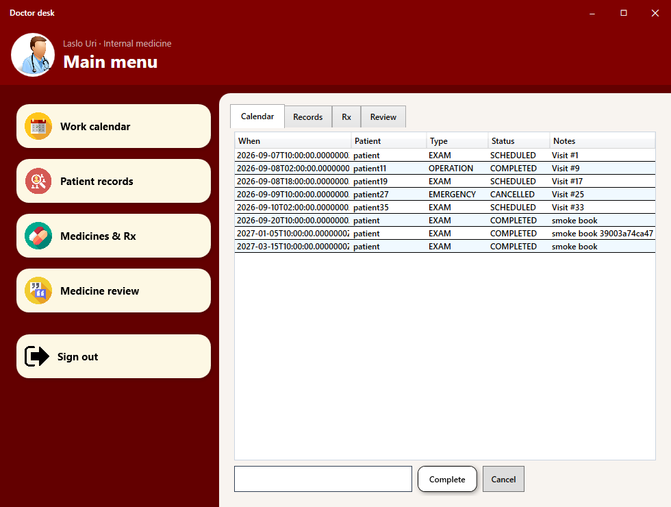
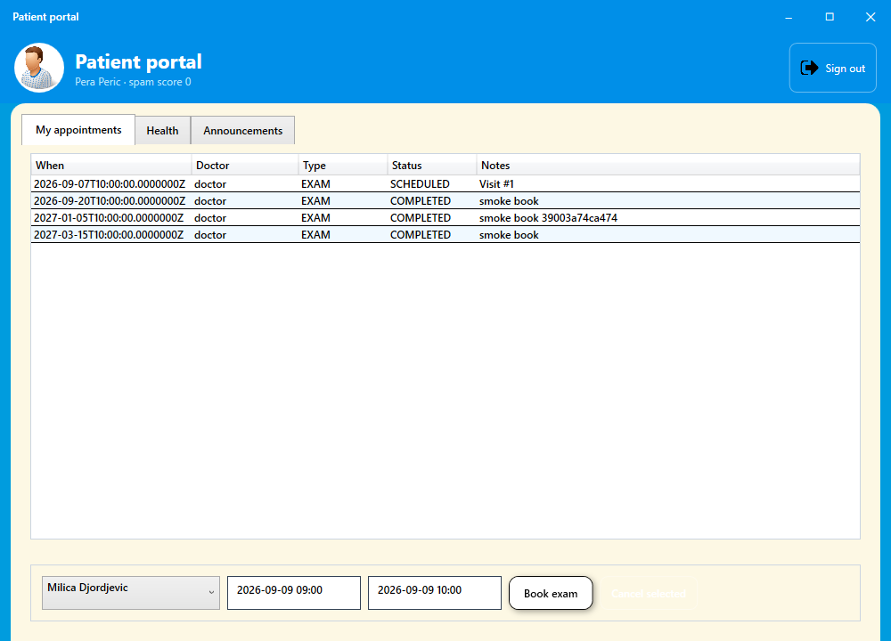
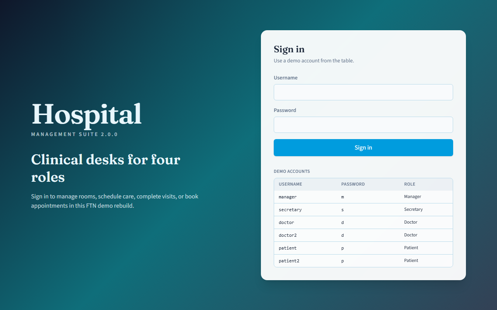
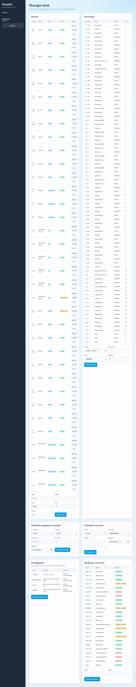
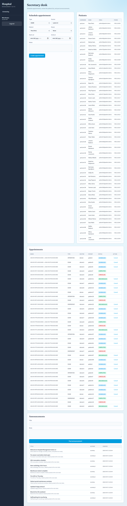
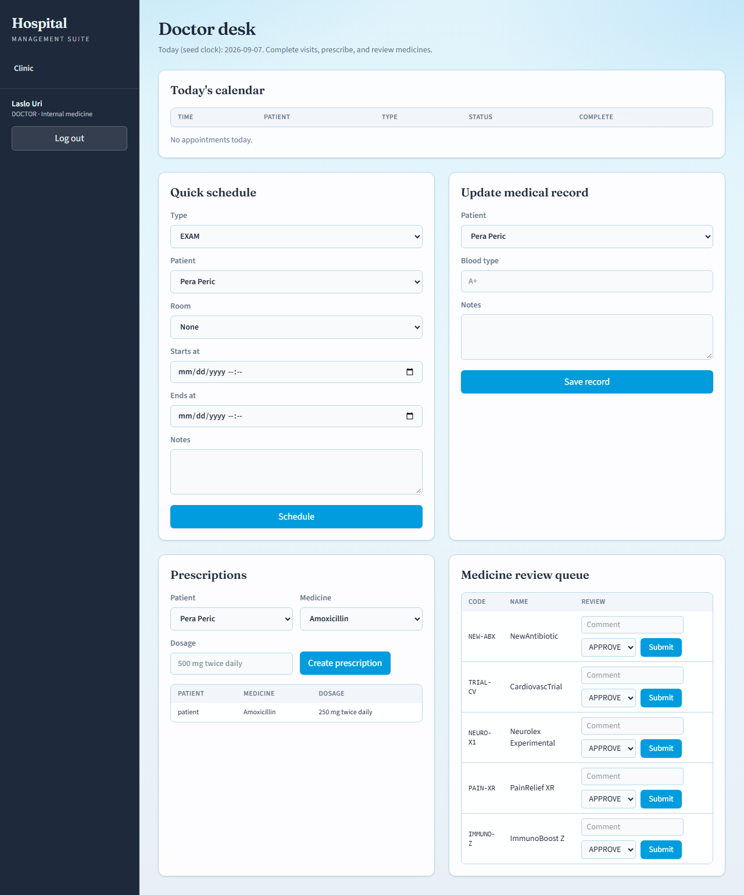
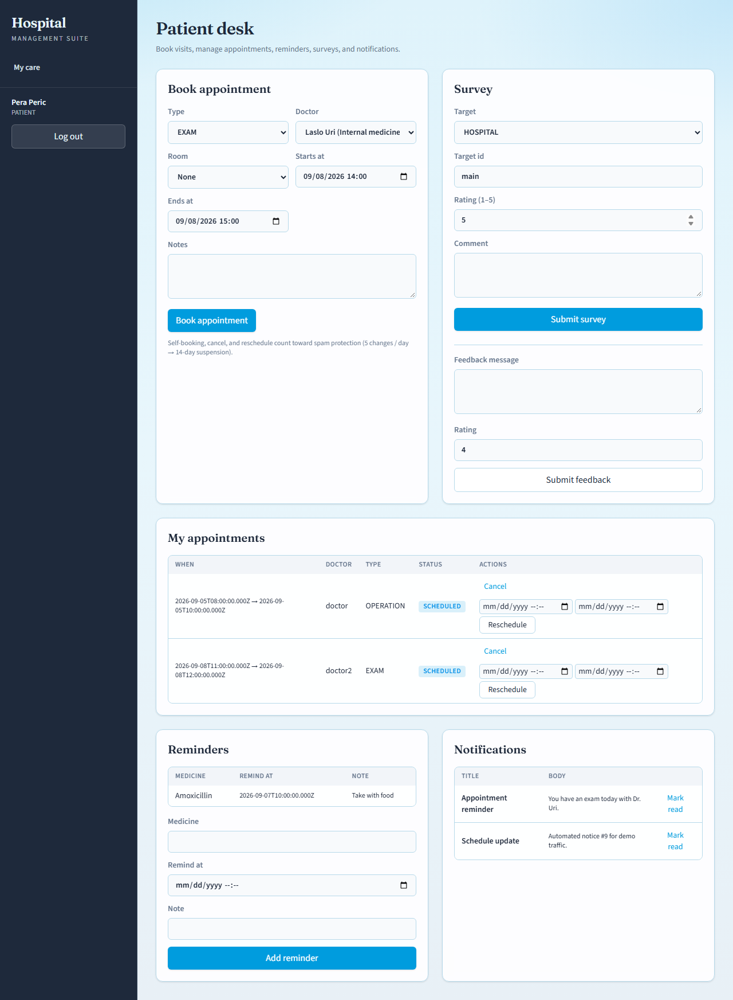

## Kontrola dokumenta

| Polje | Vrednost |
|---|---|
| Naslov | Tehnički dosije 2.0.0, Hospital Management Suite 2.0.0 |
| Verzija dosijea | 2.0.0 |
| Verzija softvera | 2.0.0 |
| Prikazni brend | **Hospital** (cijan `#009CDE`, doktor bordo `#630000`) |
| Prethodnik | Tehnički dosije 1.0.0 (**Bolnica**), `5b69c9c` |
| Prerada | 7. septembar 2026. |
| Autori | Rastislav Kukučka, Mihajlo Ostojić, Laslo Uri, Milica Vučinić |
| Arhiva | [github.com/laslo-uri/HospitalManagementSuite](https://github.com/laslo-uri/HospitalManagementSuite) |

## 1. Svrha

Ovo je **tehnički dosije 2.0.0**. Opisuje **Hospital Management Suite** posle prerade: iste četiri uloge kao 1.0.0, engleski identifikatori, Next.js 16 web, .NET 8 WPF desktop, SQLite (`schemaVersion` **2**), heširane web lozinke i UI na EN/SR/HU.

Par je [tehničkog dosijea 1.0.0](technical-dossier.sr.md) (zamrzavanje **Bolnica** u `_legacy-1.0.0/`).

## 2. Identifikacija

| Stavka | Detalj |
|---|---|
| Prikazno ime | Hospital Management Suite |
| Web | `app/` Next.js |
| Desktop | `desktop/HospitalDesktop/` |
| Perzistencija | SQLite, seed verzija **2** |
| Jezici UI | engleski, srpski, mađarski |

## 3. Odnos prema 1.0.0

WPF .NET Framework + JSON zamenjeni Next.js + .NET 8 + SQLite. Brend **Bolnica** → **Hospital**. Identifikatori na engleskom. 1.0.0 ostaje preko `run-1.0.0.bat`.

## 4. Opseg

Lokalni pult sa četiri uloge: prostorije, inventar, lekove, termine, obaveštenja. Web je bogatiji (poslovi, transferi, ankete, podsetnici). Desktop prati 1.0.0 tok sa istim vizuelnim jezikom. Neki stari moduli (odmori, hospitalizacije, uputi) još nisu u punoj paritetnosti.

## 5–6. Interfejs

*Slika 1. Desktop prijava 2.0.0.*

*Slika 2. Upravnik — desktop.*

*Slika 3. Sekretar — desktop.*

*Slika 4. Lekar — desktop.*

*Slika 5. Pacijent — desktop.*

*Slika 6. Web prijava 2.0.0.*

*Slika 7. Upravnik — web.*

*Slika 8. Sekretar — web.*

*Slika 9. Lekar — web.*

*Slika 10. Pacijent — web.*

## 7. Arhitektura i seed

| Oblast | Putanja |
|---|---|
| Web | `app/src/` |
| Desktop | `desktop/HospitalDesktop/` |
| Zamrzavanje | `_legacy-1.0.0/` |

Seed verzija **2** (~10× više podataka). Demo: `manager`/`m`, `secretary`/`s`, `doctor`/`d`, `patient`/`p`.

## 8. Bezbednost i provera

bcrypt i POST prijava na webu; role guardovi; EN/SR/HU. `npm run check`, Release build desktopa i `--smoke` prošli 7. septembra 2026.
