## Kontrola dokumenta

| Polje | Vrednost |
|---|---|
| Naslov | Tehnički dosije 1.0.0, Bolnica 1.0.0 |
| Verzija dosijea | 1.0.0 |
| Verzija softvera | 1.0.0 (arhivska oznaka; naslov prijave je i dalje `MainWindow`) |
| Razvoj | 16. mart 2021 – 21. jun 2021. |
| Glavna implementacija | kraj marta – 10. jun 2021. |
| Git zamrzavanje | `5b69c9c` (21. jun 2021) |
| Prvi commit | `8fe447c` (16. mart 2021) |
| Broj commit-a | 305 |
| Upstream | github.com/kukuckarastislav/SIMS_IS_Bolnica |
| Arhivski remote | github.com/laslo-uri/HospitalManagementSuite |
| Putanja zamrzavanja | `_legacy-1.0.0/` |
| Dosije sastavljen | 7. septembar 2026. |
| Autori | Rastislav Kukučka (RA 129/2018), Mihajlo Ostojić (RA 134/2018), Laslo Uri (RA 135/2018), Milica Vučinić (RA 139/2018) |
| Institucija | Fakultet tehničkih nauka, Univerzitet u Novom Sadu, Računarstvo i automatika |

## 1. Svrha

Ovo je **tehnički dosije 1.0.0**. Opisuje Bolnicu u commitu `5b69c9c`, u `_legacy-1.0.0/`. Radna je datoteka za preradu: šta je stari paket radio, kako je složen, šta ne kopirati.

7. septembra 2026. arhiva je kompajlirana (MSBuild Build Tools + NuGet reference assemblies), pokrenuta iz `bin\Debug`, i snimljena sa semenim nalozima. UML u `_legacy-1.0.0/Dijagrami/` i `Revizije/` ostaju kursni artefakti.

## 2. Identifikacija

| Stavka | Detalj |
|---|---|
| Prikazno ime | Bolnica (`MainWindow` na prijavi) |
| Englesko / srpsko / mađarsko | Hospital Management Suite / Bolnica / Kórházkezelő rendszer |
| Rešenje | `_legacy-1.0.0/BolnicaProjekat/Bolnica/Bolnica.sln` |
| Stack | WPF, .NET Framework **4.7.2**, System.Text.Json, iText7, LiveCharts |
| Perzistencija | 19 JSON u `_legacy-1.0.0/.../podaci/` |
| Jezik UI | Srpski |

Uloge: Upravnik Rastislav Kukučka; Sekretar Mihajlo Ostojić; Lekar Laslo Uri; Pacijent Milica Vučinić. Git: 84 / 78 / 77 / 66.

## 3. Istorijski kontekst

FTN SIMS + HCI: četiri aktera, termini, recepti, prostorije/oprema, JSON umesto SQL.

| Datum | Događaj |
|---|---|
| 16. mar 2021. | Repo, uloge, use-case |
| 21–28. mar 2021. | Klasni dijagrami |
| apr–maj 2021. | UI, repozitorijumi, seme |
| početak juna 2021. | Aktivnosti / sekvence, KT4 |
| 10. jun 2021. | Clean code / SOLID |
| 21. jun 2021. | Tip `test - git nalog` |
| 7. sep 2026. | Parkiranje u `_legacy-1.0.0/`, snimci UI |

## 4. Obuhvat

Lokalna višerolna desktop aplikacija: jedna prijava, četiri ljuske, zajednički singleton repozitorijumi. Nisu četiri instalera, nije mrežni HIS, lozinke nisu heširane. „Četiri aplikacije“ = četiri persone na jednom `Bolnica.exe`.

## 5. Korisnički interfejs iz 2021.

Snimci 7. septembra 2026. Dokaz zamrzavanja, ne cilj za preradu.

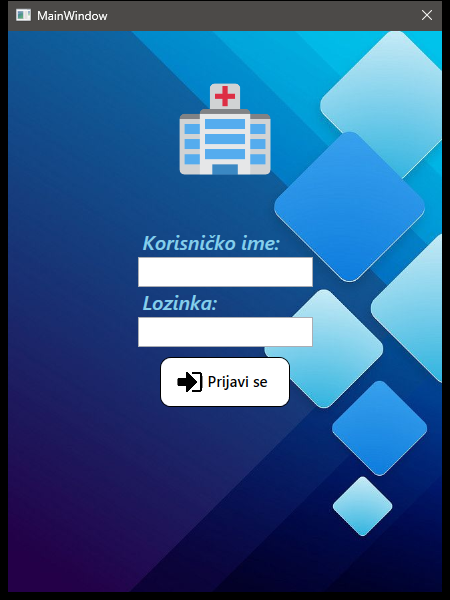

*Slika 1. Prijava — `MainWindow`, cyan pozadina, Prijavi se.*

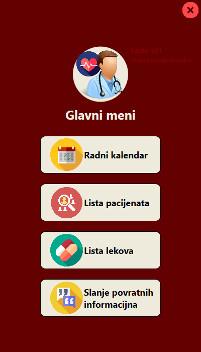

*Slika 2. LekarHome — Glavni meni (Laslo Uri).*

*Slika 3. Radni kalendar — Današnji prazan na satu 2026.*

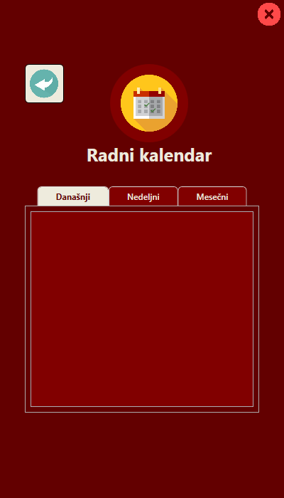

*Slika 4. Lekovi u lekarskoj ljusci.*

*Slika 5. SekretarHome — Zdravo Bolnica, čarobnjak sa greškama (aplikacijum, dogme).*

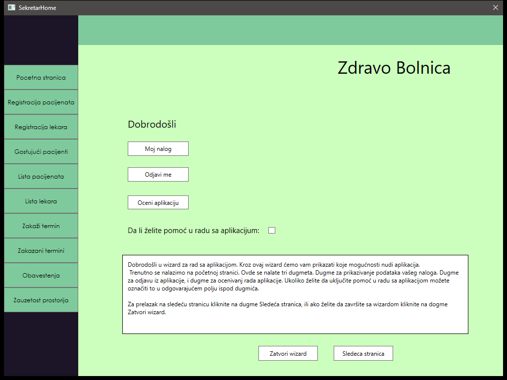

*Slika 6. Sekretarska ljuska posle navigacije ka terminima.*

*Slika 7. UpravnikHome — Prostorije; semen sadrži test redove (TESTsoba3321).*

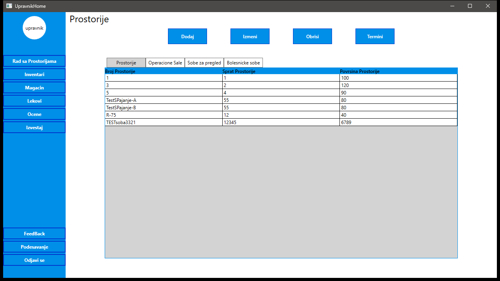

*Slika 8. Isti prikaz prostorija.*

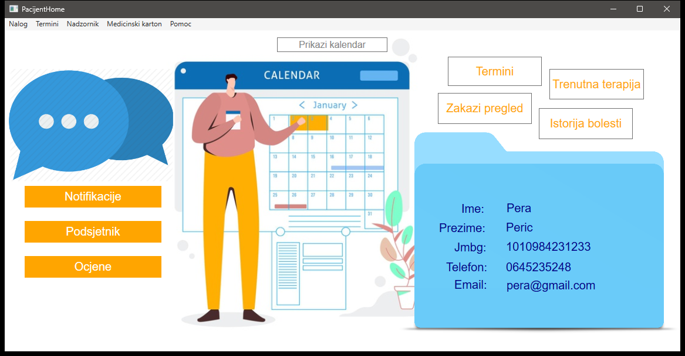

*Slika 9. PacijentHome — Pera Peric.*

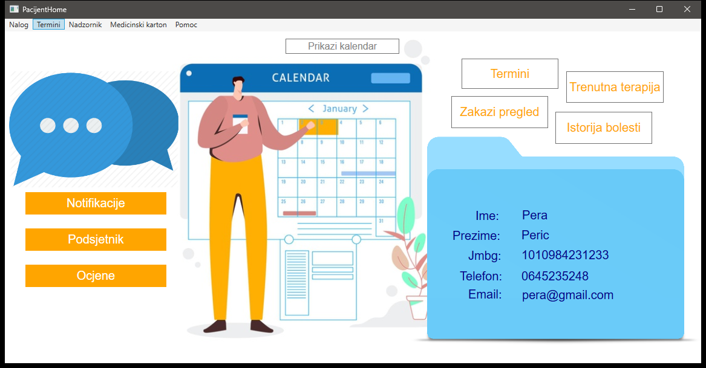

*Slika 10. Pacijent posle Termini.*

Prijava redom proverava sekretara, upravnika, lekara, pacijenta **bez ranog return-a**.

## 6. Funkcionalna specifikacija

**Upravnik.** Prostorije (renovacija, spajanje, deljenje, transfer); inventar; magacin; lekovi sa revizijom; ocene; PDF; podešavanja.

**Sekretar.** Čarobnjak, registracija, zakazivanje (i hitno), obaveštenja, zauzetost prostorija.

**Lekar.** Kalendar, karton, terapija, hospitalizacija, uput, recepti, revizija lekova.

**Pacijent.** Zakazivanje, anti-spam (~14 dana), notifikacije, podsjetnici, karton, ankete.

## 7. Slučajevi korišćenja

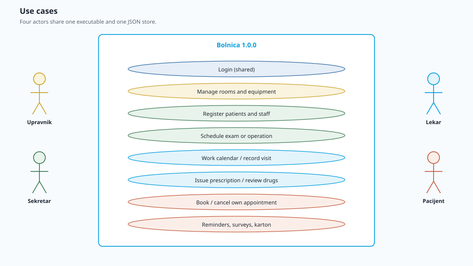

*Slika 11. Četiri aktera. PowerDesigner: `_legacy-1.0.0/Dijagrami/UseCase/`.*

## 8. Domenski model

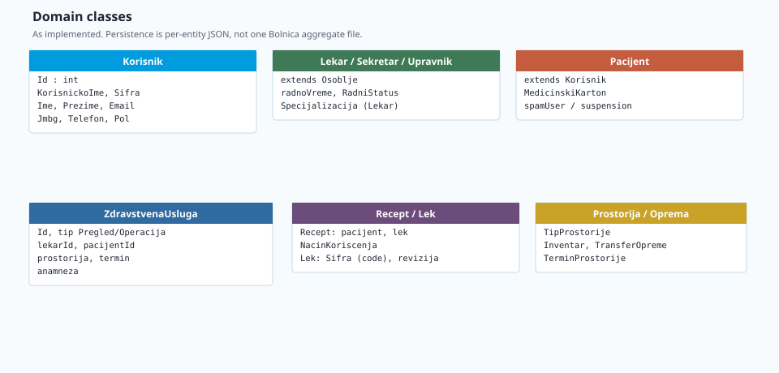

*Slika 12. Korisnik / Pacijent / Osoblje; ZdravstvenaUsluga, Recept, Prostorija, Oprema, …*

## 9. Arhitektura

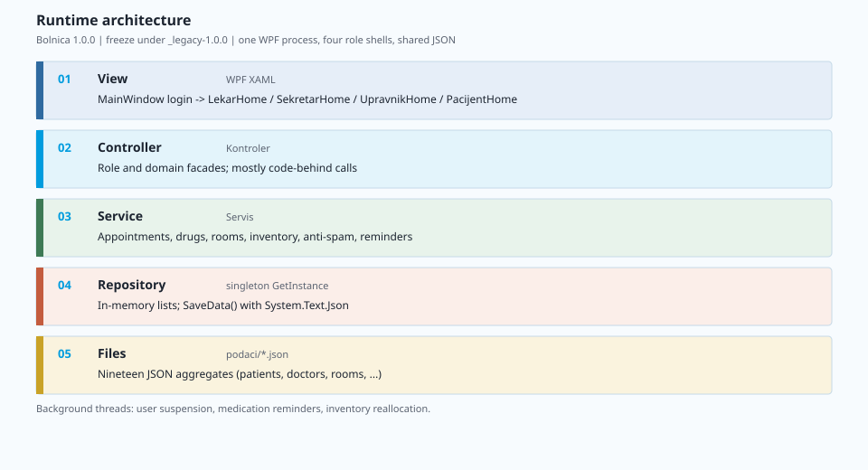

*Slika 13. View → Kontroler → Servis → Repozitorijum → JSON. Delimičan MVVM (3 ViewModel-a).*

## 10. Ključne sekvence

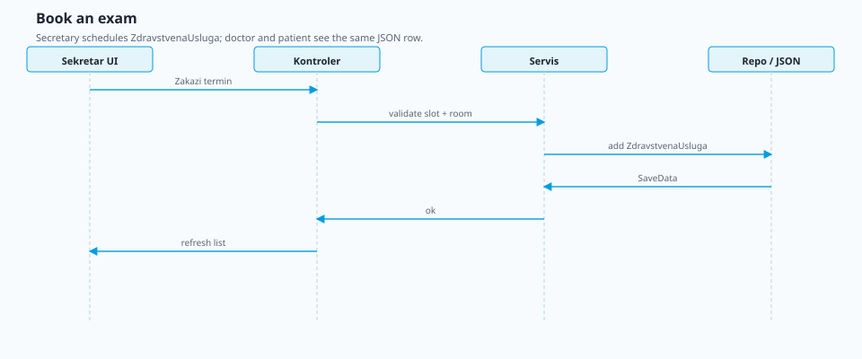

*Slika 14. Sekretar zakazuje pregled.*

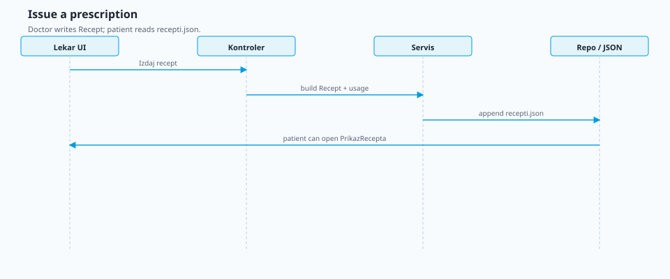

*Slika 15. Lekar izdaje recept.*

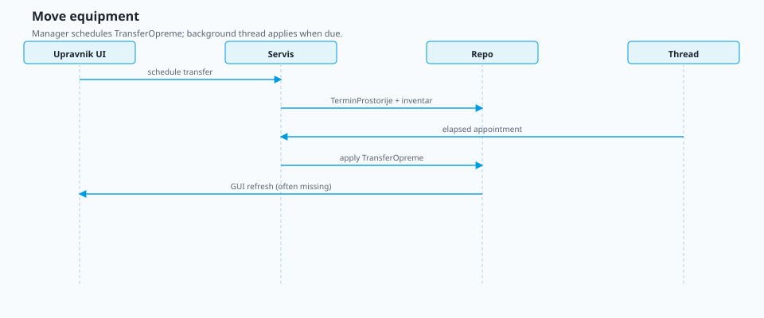

*Slika 16. Upravnik raspoređuje opremu (fali GUI refresh po reviziji).*

## 11. Perzistencija

Devetnaest JSON u `_legacy-1.0.0/.../podaci/`. Put `../../podaci/` iz `bin\Debug`. Bez migracija i zaključavanja. Semen prostorija sadrži test smeće.

## 12. Validacija i bezbednost

Lozinke u čistom tekstu; statička `App` sesija; prijava može otvoriti više ljuski; nema heširanja; čarobnjak sa greškama u tekstu.

## 13. Problemi i tehnički dug

| Oblast | Šta nije u redu |
|---|---|
| Bezbednost | Plaintext `Sifra`; višestruki login |
| Perzistencija | Relativne putanje; overwrite; test prostorije u semenu |
| Arhitektura | Nepotpun MVVM; prazan SQL factory |
| UI | Naslov `MainWindow`; prazan današnji kalendar 2026; tipfeleri u čarobnjaku |
| Dijagrami | Revizije: fali refresh, imena metoda, anti-trol flag |
| Build 2026 | Često nema system targeting pack — NuGet reference assemblies |
| „4 aplikacije“ | Jedan EXE |

## 14. Posledice za preradu

**Zadržati domen:** četiri uloge, termini, recepti, prostorije/oprema, anti-spam.

**Zameniti mašineriju:** aktuelni stack, heš lozinke, šema, konzistentan UI.

**Ne kopirati:** plaintext lozinke; login bez early-return; prazne SQL grane; test smeće u semenu.

## 15. Gradnja i provera 2026.

.NET 4.7.2, NuGet, MSBuild Build Tools. `run-1.0.0.bat` koristi `FrameworkPathOverride` kada nema system targeting pack. Snimci u odeljku 5 potvrđuju uspešan run.

---

## Dodatak A. Semeni korisnici

| Korisničko ime | Lozinka | Uloga |
|---|---|---|
| `rastislavkukucka` | `sifra` | Upravnik |
| `mihajloostojic` | `sifra` | Sekretar |
| `LasloUri` | `laci` | Lekar |
| `peraperic` | `pera` | Pacijent |

## Dodatak B. Mapa JSON

Vidi odeljak 11.

## Dodatak C. Git

Tip `5b69c9c`. Korijen `8fe447c`. Zamrzavanje u `_legacy-1.0.0/`.

## Dodatak D. Pokretanje

`run-1.0.0.bat` ili restore + build pod `_legacy-1.0.0/BolnicaProjekat/Bolnica`, `Bolnica.exe` iz `bin\Debug`.

## Dodatak E. Kursni crteži

`_legacy-1.0.0/Dijagrami/`, `_legacy-1.0.0/Revizije/*.txt`.

Sastavljeno 7. septembra 2026. iz commit-a `5b69c9c`. Dosije 1.0.0.
